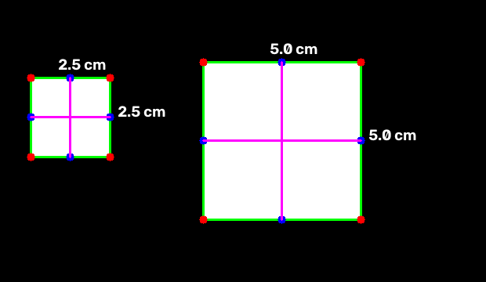

# Pengukuran Dimensi Objek

Mengukur panjang dan lebar objek pada foto dengan referensi berukuran diketahui.
Input `--width` dan hasil pengukuran menggunakan **cm**.

Inspired by [Pawan Bansal (hackbansu)](https://github.com/hackbansu) dan
[Adrian Rosebrock](https://pyimagesearch.com/2016/03/28/measuring-size-of-objects-in-an-image-with-opencv/).
Kode pengukuran diadaptasi dari [Practical-CV](https://github.com/Practical-CV/Measuring-Size-of-Objects-with-OpenCV).

## Menjalankan

```sh
python3 -m venv .venv
source .venv/bin/activate
python -m pip install -r requirements.txt
python object_size.py --image images/sample_cm.png --width 2.5
```

`--width` adalah lebar objek referensi **paling kiri**, dalam cm, bukan lebar
benda yang ingin diukur. Contoh sintetis menggunakan referensi persegi 2.5 cm
di kiri dan target 5 × 5 cm di kanan. Untuk foto sendiri, masukkan ukuran
referensi yang benar dalam cm.

Tekan tombol apa saja pada jendela gambar untuk melihat objek berikutnya.
`object_size_mine.py` menampilkan tahap edge dan morfologi sebelum pengukuran;
parameter dan satuannya sama.

## Kondisi foto

- Referensi dan benda berada pada bidang yang sama, tidak saling menutupi.
- Kamera menghadap hampir tegak lurus ke bidang objek.
- Background kontras agar tepi benda terdeteksi.
- Ukuran dihitung dari kotak contour, bukan rekonstruksi 3D. Perspektif,
  distorsi lensa, dan segmentasi dapat membuat hasil meleset.

## Contoh hasil



Gambar sintetis untuk memeriksa perhitungan dan label cm, bukan hasil
pengukuran benda fisik.

## Tes

```sh
python -m unittest discover -v
```

Tes memakai gambar sintetis tanpa membuka jendela. Akurasi foto nyata belum
dikalibrasi.
Repository sumber tidak mencantumkan lisensi; periksa izin sebelum distribusi ulang.
